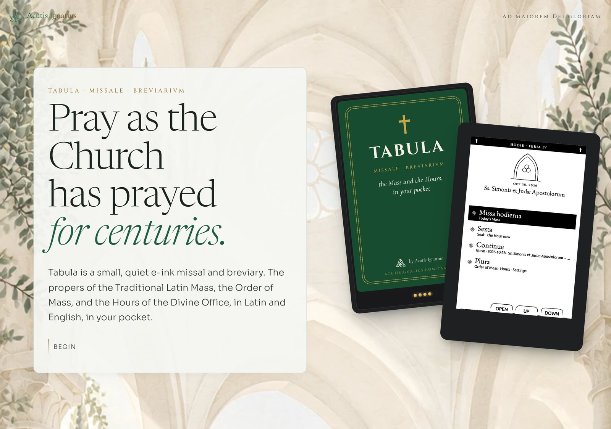
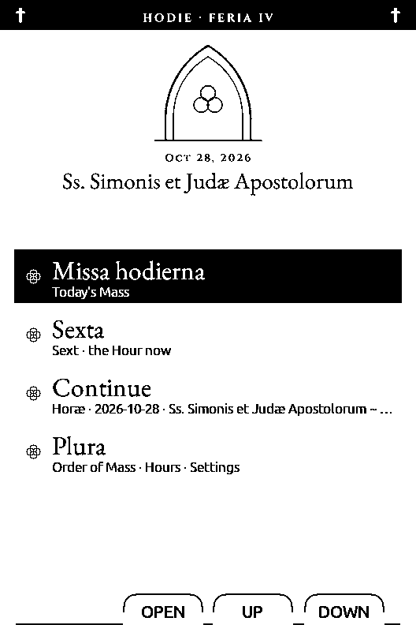
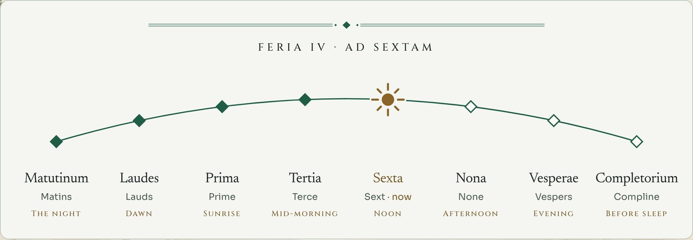
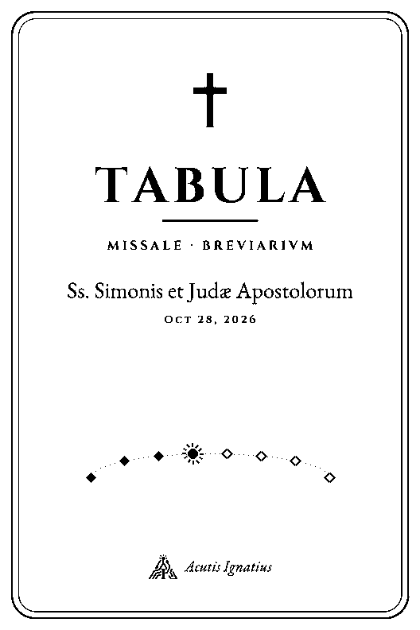

# Tabula · Missale · Breviarium

**Pray as the Church has prayed for centuries.**

Tabula is a small, quiet e-ink missal and breviary. It carries the propers of
the Traditional Latin Mass, the Order of Mass, and the Hours of the Divine
Office, in Latin and English, in your pocket.

[acutisignatius.com/tabula](https://acutisignatius.com/tabula/) · a passion project of [Acutis Ignatius](https://acutisignatius.com)



> *Lauds* at dawn, *Vespers* at dusk, *Compline* before sleep. The Church
> gives each part of the day its prayer. Tabula keeps those prayers close.

---

## Quiet by design



**Nothing asks for your attention.** There are no apps, feeds or
notifications. The screen is paper-like and easy on the eyes. One button opens
and one goes back.

Today's Mass and the Hour being prayed now are always the first thing you see.
They are there for a few quiet minutes of prayer before you leave for church.

There is no file browser and no library to manage. Tabula opens on **Hodie**
(today), with the day's feast under a Gothic lancet:

- **Missa hodierna**: today's Mass
- **The Hour now**: Lauds, Sext, Vespers or Compline, chosen by the clock
- **Continue**: back to where you were reading
- **Plura**: the Order of Mass, all eight Hours, and a short Settings list

The arched labels under the screen name what each front button does,
including while you read.

<br clear="right">

## Proprium de Tempore: know what's coming

The propers of each day's Mass arrive on their own: Introit, Collect,
Epistle, Gradual, Gospel, Offertory and Communion. Pray with them at home
before Mass, and you'll arrive already knowing what will be prayed.

Read just the propers, or the whole Mass straight through. Each Latin line has
its English directly beneath, set close together, in regular and italic type.
The gap falls between pairs, never inside one.

## Ordo Missae: learn the shape of the Mass

The whole Mass sits on one line, from the prayers at the foot of the altar to
the Last Gospel. Today's propers are marked, with the unchanging Ordinary
between them. Each part shows a small figure: **kneel**, **stand** or
**sit**.

## Officium Divinum: pray the Hours in English, in Latin, or both

Lauds, Vespers, Compline and the rest of the Divine Office. Pray in Latin, in
English, or both together; the choice is in Settings.

The Latin carries the very words that monks, saints and ordinary faithful
have prayed for well over a thousand years.



*“Seven times a day I have given praise to thee.”* The Hours sanctify the
whole day: the Church at prayer from the watches of the night to the falling
of evening.

## At rest



When Tabula sleeps, its screen keeps the day:
- the name **TABULA** under a cross
- *Missale · Breviarium*
- today's feast and the date
- the eight Hours on an arc, with a sun on the Hour now

It's drawn in one tone: all light, or all dark if you choose Dark in
Settings.

<br clear="left">

## Res ipsa: small enough to keep beside you

Smaller than a holy card, and just 5 mm thin. The back carries its name in
Latin, *Missale · Breviarium*: the missal and the breviary.

| | |
|---|---|
| **Size** | 64 × 98 mm, 5 mm thin, 58 g |
| **Screen** | 3.7 in e-ink, like paper; best read in good light |
| **Texts** | 1962 Missal propers and Ordinary; the Divine Office; daily readings |
| **Languages** | Latin with English |
| **Charging** | Magnetic, on the back |

**Semper tecum.** Tabula has magnets in its back. On a phone with MagSafe it
holds on with the screen facing out, so it comes with you. The magnets hold
gently; a MagSafe case or ring holds it more firmly. It also fits easily in a
pocket.

## Pro paroeciis: made for our parishes

Tabula is a work of love by Acutis Ignatius. A small number are prepared by
hand for our parishes and offered at cost, with the proceeds given to the
Church.

The liturgical texts come from the [Divinum Officium](https://www.divinumofficium.com)
project, with English from the Douay-Rheims. The software is built on the
open-source [CrossPoint Reader](https://github.com/crosspoint-reader/crosspoint-reader).

**Need a hand?** If your Tabula won't turn on, you'd like help joining Wi-Fi,
or something doesn't look right, write to
[tabula@acutisignatius.com](mailto:tabula@acutisignatius.com). It helps to
mention what you were doing and the version shown under Settings → About.

*Ad maiorem Dei gloriam.*

---

## Technical information

Tabula is a fork of [CrossPoint Reader](https://github.com/crosspoint-reader/crosspoint-reader)
(based on `develop` @ `0727f9f`). CrossPoint's own README is kept in
[CROSSPOINT.md](CROSSPOINT.md). Tabula code is behind `#if TABULA`, so the
upstream builds are unchanged.

### Hardware

- **Device:** Xteink X3, ESP32-C3 (single-core RISC-V, about 380 KB usable
  RAM, **no PSRAM**), 3.7 in 528 × 792 one-bit e-ink panel, microSD card.
- The USB port is the C3's fixed-function Serial/JTAG. There is no USB drive
  mode, so the card is loaded over the serial link or by removing it.
- Wi-Fi is 2.4 GHz only.

### Builds

| Env | For | What |
|---|---|---|
| `tabula_dev` | Development | `-DTABULA=1`. Tabula screens, plus all CrossPoint features and the serial card loader. |
| `tabula_parish` | Parishioners | Adds `-DTABULA_PARISH=1`: locked down, English UI only. The only image that ships. |

```sh
pio run -e tabula_dev                                     # build
pio run -e tabula_dev -t upload --upload-port <port>      # flash (wake the X3 first)
```

Opening the serial port resets the X3. A sleeping X3 has no USB port, so press
a button before flashing.

### Firmware layout

| Path | What |
|---|---|
| `src/activities/tabula/` | Today (`TabulaHomeActivity`), Plura, Hours, Settings, Order of Mass, date and Hour logic (`TabulaDay`), shared Chorus ornaments (`TabulaArc`) |
| `src/components/themes/tabula/` | `TabulaTheme`: arched button-hint niches over the Lyra theme |
| `src/activities/boot_sleep/SleepActivity.cpp` | Sleep screen: the day's art plus the live Hours arc, light or dark |
| `src/activities/reader/` | Reader changes under `TABULA`: button hints under every page, a short menu (Contents, Mark this page, Home), "Loading" instead of "Indexing" |
| `src/CrossPointSettings.*` | `tabulaText` (Latin + English / Latin / English), `tabulaMass` (propers / full), `tabulaSleepDark`, `tabulaLayout` |
| `src/main.cpp` | Dev-only serial card loader (`CMD:PUT`, `CMD:STAT`) |

### Content pipeline

The liturgical calendar is worked out on a computer, not on the device. The
firmware only maps today's date to file names.

1. **Texts:** the Divinum Officium data, exported with the backmuse
   `tools/office` scripts for the 1962 rubrics. This produces one year of Mass
   and Office JSON.
2. **Books:** `docs/tabula/tools/build_sd_content.py` writes EPUBs in three
   editions: bilingual, Latin (`.la`) and English (`.en`).
   - Each Latin clause is paired with its English, in one paragraph per pair.
   - Chapter ids follow `docs/tabula/sd/Tabula/Missal/ordo.json`, so Today can
     open a book at the Introit or at the Hour now.
3. **Art:** `docs/tabula/tools/render_tabula_art.py` draws each day's Today
   header and sleep screen as one-bit BMPs. It checks that no ornament
   overlaps text.
4. **Font:** EB Garamond (OFL), converted to `.cpfont` at 14 to 22 pt by
   `lib/EpdFont/scripts/build-sd-fonts.py` with
   `docs/tabula/tools/tabula-fonts.yaml`. The C3 can't render TrueType at
   runtime.
5. **Card:** `docs/tabula/tools/load_card.py` sends `build/tabula-sd` over USB
   serial in 8 KB chunks, each acknowledged and checked with CRC32. It skips
   files already on the card and can resume.

Card layout:

```
/.fonts/EBGaramond/                    reading font (.cpfont)
/Tabula/Today/<date>.propers{,.la,.en}.epub
/Tabula/Today/<date>.full{,.la,.en}.epub
/Tabula/Today/<date>.head.bmp           Today header art
/Tabula/Hours/<date>.hours{,.la,.en}.epub
/Tabula/Sleep/<date>.bmp                sleep screen art
/Tabula/Missal/Ordo-Missae{,.la,.en}.epub, ordo.json
```

### Tools

| Tool | What |
|---|---|
| `docs/tabula/tools/grab_screen.py` | Saves what the X3 is showing as a PNG, through the firmware's `CMD:SCREENSHOT`. The screens in this README were captured with it. |
| `docs/tabula/previews/screens.html` | HTML previews of the design directions |

### Design docs

- [docs/tabula/DESIGN.md](docs/tabula/DESIGN.md): system design and parish lockdown
- [docs/tabula/NETWORK_UPDATES.md](docs/tabula/NETWORK_UPDATES.md): plan for updating texts and firmware over Wi-Fi (not built yet)
- [docs/tabula/handoff.md](docs/tabula/handoff.md): setup, hardware and content notes
- [docs/tabula/brand/STICKER.md](docs/tabula/brand/STICKER.md): the back sticker

### Licenses

- Firmware: MIT, from CrossPoint Reader and the FreeInk SDK
- wolfSSL: GPL v2, so this source is public
- Liturgical texts: Divinum Officium, MIT
- EB Garamond: SIL Open Font License

See [docs/tabula/LICENSES.txt](docs/tabula/LICENSES.txt).

Tabula is not affiliated with or endorsed by Xteink, CrossPoint Reader,
FreeInk, or the Divinum Officium Project.
